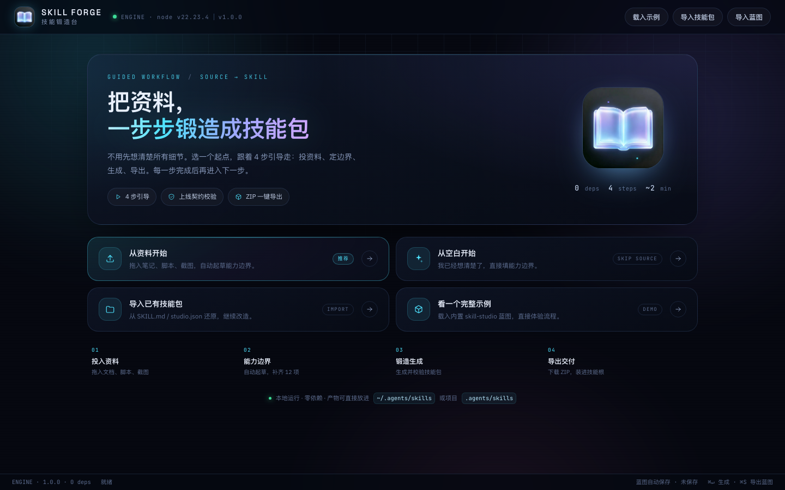
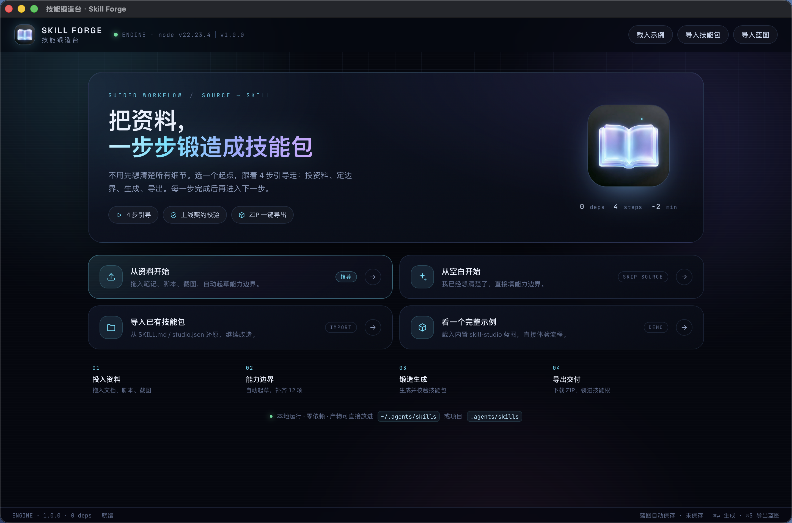
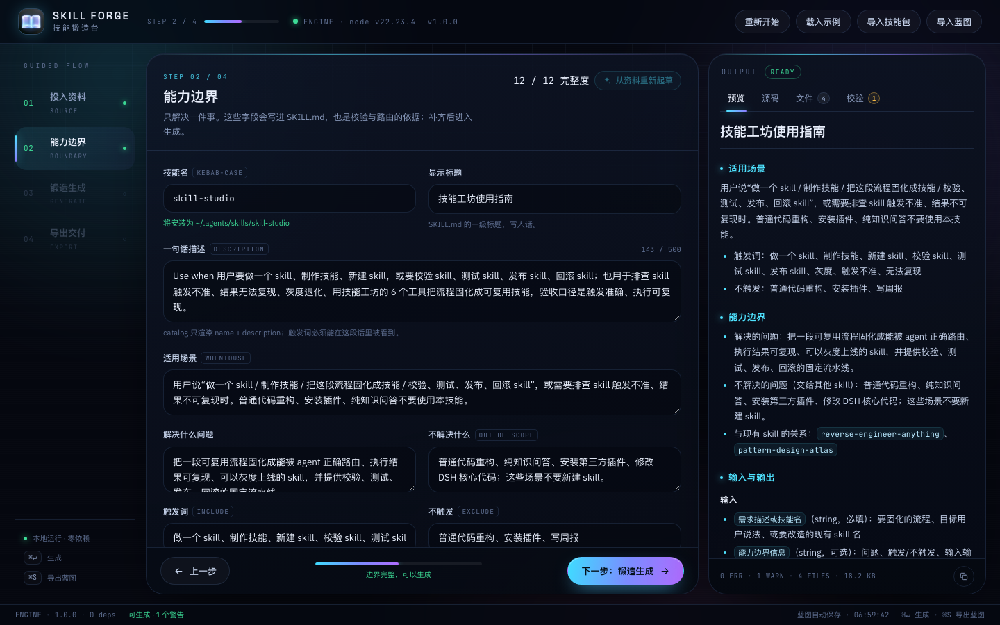

# Skill Forge · 技能锻造台

[](https://github.com/CYQ131515/skill-forge/actions/workflows/ci.yml)
[](LICENSE)
[](package.json)

**Turn scattered source material into an installable agent skill package — step by step, locally, with real validation.**

把散落的资料，一步步锻造成可直接安装的 Agent Skill 技能包。桌面端原生窗口，引导式 4 步流程，零依赖，数据不出本机。



---

## 它做什么

很多人做 skill 的难点不在写，而在「边界想不清楚、资料散落、写完不知道能不能用」。Skill Forge 把这件事拆成一条有引导的流水线：

```
投入资料 → 能力边界 → 锻造生成 → 导出交付
   ↑          ↑           ↑          ↑
 文件/脚本   12 项检查    真实校验    ZIP + 安装指引
```

每一步完成后才进入下一步；右侧 OUTPUT 实时预览 `SKILL.md`、文件树、源码和校验结果。

### 输入

- 文档、笔记、规范、脚本、截图（拖拽或选择文件）
- 已有技能包（`SKILL.md` + `studio.json` + 资源）
- 蓝图 JSON
- 空白手填

### 产出

```
<skill-name>/
├── SKILL.md                   # frontmatter + 7 个标准章节
├── scripts/                   # 可复现脚本（可保留作者自带脚本）
├── references/                # 参考资料
├── assets/                    # 图片等附加资源
├── tests/skill.test.json      # 触发正负例 + 命令用例 + 可复现
└── studio.json                # 蓝图快照，可再次导入精确编辑
```

另有 `<skill-name>.zip`，解压后可直接放进：

```
<project>/.agents/skills/<name>    # 项目灰度
~/.agents/skills/<name>           # 用户稳定
```

---

## 快速开始

### 方式一：桌面端（推荐）

**环境**：macOS 13+、Node.js 20+。构建桌面壳需要 Xcode Command Line Tools（Swift）。

```bash
git clone https://github.com/CYQ131515/skill-forge.git
cd skill-forge
./desktop/build.sh
open "../技能锻造台.app"
```

`build.sh` 会编译 Swift 壳、打包前端资源，输出到仓库同级的 `技能锻造台.app`。应用启动时会在内部拉起一个随机端口的本地 Node 服务，关闭窗口即停止。

> 构建脚本会自动选择本机可用的 macOS SDK；如果遇到 SDK / Swift 版本不匹配，可以指定：
> `SKILL_FORGE_SDK=/path/to/MacOSX.sdk ./desktop/build.sh`



### 方式二：浏览器模式（开发用）

```bash
cd skill-forge
node server.mjs
# http://127.0.0.1:4318
```

不需要 `npm install`。只监听 `127.0.0.1`。

---

## 引导式流程

1. **01 投入资料** — 拖文件、改角色、粘贴文本；「从资料自动起草」会从标题、章节、编号步骤、`触发词：` 行、`process.env.X` 中提取名称、描述、触发词、步骤和权限，然后自动进入下一步。也可以直接跳过。
2. **02 能力边界** — 12 项完整性检查：技能名、标题、描述、适用场景、解决/不解决问题、触发词、输入、输出、权限、步骤、错误码。缺项时「下一步」禁用并明确列出缺口。
3. **03 锻造生成** — 生成技能包并跑真实校验；生成成功后解锁导出，有错误可一键返回修改边界。
4. **04 导出交付** — 下载 ZIP、在 Finder 打开导出目录、按「解压 → 放进技能根 → 让 agent 路由」三步收尾；也可以「再做一个」。



其他细节：

- 左侧步骤条 / 移动端步骤胶囊 / 顶部进度条；已完成步骤可以回退，未解锁步骤会提示
- 蓝图自动保存到本地；重开应用会显示「上次编辑 · 第 N 步」继续卡
- 平板与手机自动切换单栏 + 底部「预览 / 校验」抽屉（390px 无横向滚动）
- 原生 macOS 文件选择面板、覆盖确认弹窗、退出时自动停服务

---

## 校验与安全

生成后会跑一遍上线契约校验（不是文风检查）：

- `FM*` frontmatter / kebab-case / description 长度
- `DOC*` 七个标准章节、步骤数、超时兜底
- `RES*` 资源引用、`node --check` 脚本语法、shebang 执行权限
- `SEC*` 常见密钥格式、硬编码密钥、未声明环境变量
- `OVL*` 与本机已安装技能的 description 相似度（只读扫描 `~/.agents/skills`、`~/.dsh/skills`）
- `TST*` 测试规格是否存在、是否覆盖正负例

安全边界：

- 只监听 `127.0.0.1`，无遥测、无上传
- 只写 `~/Documents/技能工坊/{exports,zips,tmp}`，外加只读扫描本机技能根
- 上传的脚本只做 `node --check` 语法检查，**不会执行**
- 密钥只登记环境变量名；疑似密钥字面量会被拒绝并脱敏

---

## 项目结构

```
skill-forge/
├── server.mjs              零依赖 HTTP 服务（静态页 + API）
├── desktop/
│   ├── SkillForge.swift    macOS 原生壳（NSWindow + WKWebView + 内嵌 node 服务）
│   ├── Info.plist          Bundle 配置
│   ├── AppIcon.icns        应用图标
│   ├── make-assets.py      从 icon-source.jpg 生成图标资源
│   └── build.sh            一键构建 .app
├── lib/
│   ├── config.js           路径 / 限制 / 技能根
│   ├── blueprint.js        蓝图归一化 + SKILL.md 生成
│   ├── frontmatter.js      YAML 子集读写
│   ├── router.js           触发路由质量与相似度
│   ├── validator.js        上线契约校验
│   ├── catalog.js          本机技能扫描
│   ├── package.js          资料落位 + 打包 + 落盘 + ZIP
│   ├── draft.js            从资料自动起草
│   ├── importer.js         导入已有技能包
│   ├── zip.js              零依赖 ZIP 写入
│   └── util.js
├── public/
│   ├── index.html          首页 + 4 步向导
│   ├── styles.css          设计系统
│   ├── app.js              步骤状态机 / 表单 / 预览 / 生成 / 导出
│   ├── fonts/              本地打包字体（OFL）
│   └── icon-book.png
├── samples/                内置示例蓝图
├── test/core.test.js       8 个核心用例
├── docs/                   界面截图
├── 启动.command            浏览器模式启动器
├── LICENSE                 MIT
└── THIRD_PARTY_NOTICES.md
```

数据目录：

```
~/Documents/技能工坊/exports/<name>-<timestamp>-<id>/   技能包目录
~/Documents/技能工坊/zips/<id>.zip                     可下载的 ZIP
~/Library/Logs/SkillForge/server.log                   桌面端内嵌服务日志
```

---

## 测试

```bash
node --test test/*.test.js
# 8 个用例：起草、资料落位、ZIP 结构、导入往返、蓝图层校验、二进制解码
```

桌面端额外手工验收过：原生窗口启动、内嵌服务自动拉起、文件选择面板、覆盖确认弹窗、关闭窗口后服务进程退出。

---

## API

| 方法 | 路径 | 作用 |
|---|---|---|
| GET | `/api/meta` | 版本、路径、本机技能目录、示例蓝图 |
| POST | `/api/draft` | `{materials, idea?}` → 起草蓝图 |
| POST | `/api/import` | `{files:[{name,path,b64}]}` → 解析 SKILL.md / studio.json |
| POST | `/api/preview` | `{blueprint, files, validate}` → 内存组装 + 可选真实校验 |
| POST | `/api/build` | 同上 → 落盘 + 校验 + ZIP |
| GET | `/api/download/<id>` | 下载 ZIP |
| POST | `/api/open` | 在 Finder 中打开导出目录 |

---

## 来源与差异

这个应用最初来自作者自己的 DSH「技能工坊」插件，保留并独立了「制作」这一段流水线（蓝图归一化、SKILL.md 生成、契约校验、触发路由质量、密钥扫描），去掉了 DSH Host 依赖，增加了引导式桌面体验。

不包含原插件的模型工具、灰度发布、回滚与运行日志。**SkillAlchemy** 等「用 agent 研究并生成 skill 内容」的项目解决的是内容来源问题；Skill Forge 解决的是「把已有资料装成可安装、可校验、可复现的包」。

---

## License

MIT © 2026 CYQ131515

字体（Space Grotesk / IBM Plex Sans / JetBrains Mono）采用 SIL OFL 1.1，许可证见 [`public/fonts/licenses/`](public/fonts/licenses/) 与 [`THIRD_PARTY_NOTICES.md`](THIRD_PARTY_NOTICES.md)。
